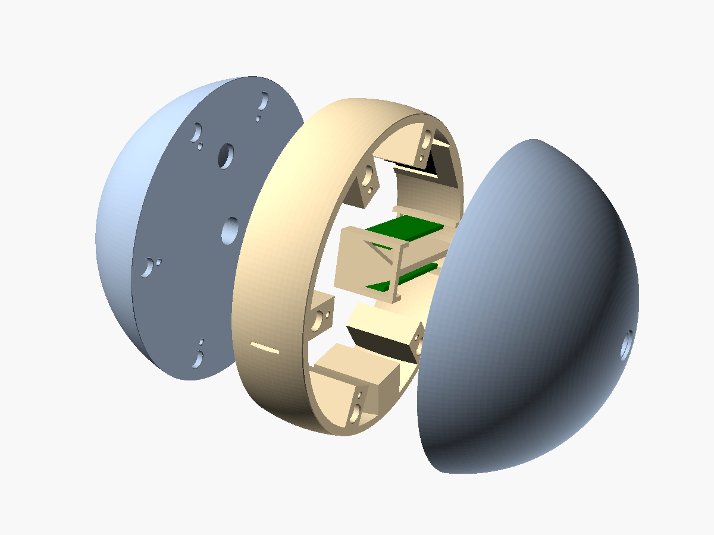

# Binaural sphere head

A 175 mm sphere that stands in for a head at a listening seat. Two Infineon IM73D122 PDM microphones sit flush in the surface at the ear points, ±90° from the front on the horizontal great circle, and one ESP32-S3 inside records both as stereo PDM on a shared clock. It measures interaural time and level differences (ITD, ILD) and interaural cross-correlation (IACC), to diagnose stereo imaging. Phase 1 of the binaural fixture: a sphere instead of a KEMAR-shaped head, no pinnae.

## Parts

| Part | STL | Print orientation | Qty |
|---|---|---|---|
| Right cap (right ear, sand chamber) | `stl/binaural_sphere_head-cap_right.stl` | seam face down, ear up | 1 |
| Left cap (mirror of the right) | `stl/binaural_sphere_head-cap_left.stl` | seam face down, ear up | 1 |
| Centre slab (electronics, display, tripod nut) | `stl/binaural_sphere_head-slab.stl` | left face down | 1 |
| Fill plug | `stl/binaural_sphere_head-fill_plug.stl` | flange down | 2 |

On the Bambu X1C, open the project files in `bambu/` instead: they carry the print settings below.

**Hardware:** 10 × 10×3 mm neodymium disc magnets; 10 × 3×12 mm steel dowel pins (or M3×12 screw shanks with the heads cut off); 1 × 1/4"-20 hex nut (7/16" across flats, 7/32" thick); sand (dry, fine) or foam; silicone or acoustic putty; double-sided foam tape.

## Why it's split this way

The head splits into a right cap, a 40 mm centre slab and a left cap, on two planes 20 mm either side of the centre. Each seam is then 67.5 mm from the nearest ear, and nothing but smooth dome surrounds either microphone. A hemisphere split on the vertical plane through the ears would run the seam across both ears. The sagittal hemisphere split keeps the ears clear but puts the electronics, tripod mount and display on the seam. The slab takes all of those, so each cap is a closed sand chamber with an ear on top.

- **Caps print ear up.** The mic pocket is a vertical bore, so it comes out round and to size, and the dome needs no support. The sand chamber inside is closed, so its ceiling can't be supported: a 45° flare rises from the wire conduit to the shell and keeps the ceiling within 55° of vertical. The flare also makes the region around each ear solid.
- **The slab prints flat.** Every feature inside it (board cradle, OLED channel, tripod boss, joint tabs) is a vertical wall in print, so it needs no support either.
- **Walls** are 4.5 mm (10 lines of 0.45 mm). Shell vibration is further damped by the sand.
- **Seams** sit at ±20 mm, not at the centre: one central split would be 87.5 mm from each ear but would put the electronics, tripod nut and display on the seam. 40 mm is the narrowest slab that holds them with room for the jumpers.

## Print settings

| | |
|---|---|
| Material | PLA (stiff, accurate; indoor use). PETG also works. |
| Layer height | 0.2 mm (0.16 mm on the caps for a smoother dome, optional) |
| Walls | 4 (1.8 mm) |
| Top/bottom layers | 5 |
| Infill | 15% gyroid. Add a 40% modifier over the top 25 mm of each cap, so the solid around the ear is stiff as printed. Print the slab at 25% (tripod boss). |
| Supports | None |
| Temperatures | Bambu PLA Basic preset (220 °C nozzle); generic PLA 200–220 °C, bed 60 °C |
| Time / filament (Bambu Studio, PLA Basic, 15%) | cap 5 h 27 min, 260 g each; slab 3 h 36 min, 160 g; about 0.68 kg in all |

Don't enable any slicer option that fills enclosed cavities: the caps are sealed hollow chambers by design.

## Assembly

1. **Microphones.** Fit Dupont jumpers to each carrier's two 3-pin headers first. Feed the wires and housings down through the ear pocket into the conduit, then press the carrier in until it sits on the seat ring, port facing out. Its face should be flush with the dome at the rim, with the centre ≤0.35 mm below the sphere. Seal the ring gap round the carrier with a thin bead of silicone or acoustic putty, wiped flush. The acoustic port must stay open and nothing may sit in front of it. Nothing else holds the carrier, so also fix it from inside: a few drops of CA glue or silicone where its rim meets the seat ring.
2. **Magnets and pins.** Glue the magnets into the pockets on both faces of the slab and on both cap plates. Check polarity before the glue sets. Put every slab magnet in north face out, on both faces, and every cap magnet south face out. Then any cap fits either side, and no magnet repels. A compass or a spare marked magnet tells the poles apart. Press the dowel pins into the slab (tight holes, 7 mm deep; glue them if they come out loose). The cap holes are a sliding fit.
3. **Tripod nut.** Drop the 1/4"-20 nut into the slot from the slab's right face. The right cap closes the slot. The nut sits 2 mm above the bottom flat, so a camera screw protruding 4.5 mm engages about 2 turns; a stud of 6 mm or more is better for the full 2.4 kg.
4. **ESP32.** Stick a strip of 1 mm double-sided foam tape on the top edge of the web. Put the board in pins-down (toward the left cap), USB-C end into the slot on the back, so it sits between the side fingers and the far-end stop. Put a 4–5 mm pad of soft foam on top of the module shield: the right cap's plate presses on it and keeps the board seated. Without it the board can float up and the USB-C receptacle can jam above the slot.
5. **OLED.** Slide the module into its channel from the slab's right face, glass toward the window, header edge up. The right cap's plate holds it along the slot. Put a strip of foam tape between the back of its PCB (below the header) and the channel, or a drop of hot glue at two corners, so the glass stays pressed against the window flat.
6. **Wiring.** Pass the jumpers from each conduit mouth (centre of each cap plate) to the board. Leave enough slack to open the head.
7. **Fill** (below), then close: press each cap on, guided by the pins, until the magnets pull it home. To open, put a thumbnail or a plastic spudger in the pry notch at the bottom-back of each seam.

## Sand fill

Each cap holds about 0.54 L of chamber volume.

1. Stand the cap seam face up. Pour dry, fine sand through the fill port, tapping the dome as you go, until it is full to the port.
2. Press the fill plug in with a smear of silicone on its shank.

Full chambers add about 1.7 kg (dry sand at about 1.6 g/cm³), for a total of roughly 2.4 kg. That damps the shell and steadies the head on the stand, but the tripod and head must carry it. A partial fill still damps. Open-cell foam is the light alternative.

## Known compromises

- The band is notched inward above the ESP32 (3.7–4.5 mm instead of 4.5 mm), because the board's corners would hit the band on the way in from the seam. The front notch, pry notches, USB slot and OLED flat also thin the shell locally. All are on the back, front or bottom, at least 100 mm from the ears.
- The 2 mm strip of band between the OLED window and the right seam is slender. Handle that edge with care when the right cap is off.
- The electronics bay (about 0.8 L) vents through the USB slot, a Helmholtz resonance estimated at roughly 200 Hz (not measured). It is on the back, far from the ears; a loose wad of open-cell foam in the bay damps it.
- The dome terraces visibly within ~8 mm of each ear at 0.2 mm layers. Variable layer height (0.12 mm on the top 15 mm of each cap) smooths it.

## Wiring notes

Both microphones share **CLK** and **DATA**; the ESP32-S3 records them as one stereo PDM stream (PDM RX on I2S0). The **SELECT** (L/R) pin goes to GND on one mic and to VDD on the other, so each drives DATA on a different clock edge. Power both from the board's 3.3 V. Which mic is "left" in the data, and which GPIOs carry CLK and DATA, are set in the firmware, not here. Keep the two jumper runs to similar length and twist each mic's CLK and DATA with a ground.

The OLED is I2C (GND, VCC, SCL, SDA on the header at its top edge).

## Placeholders: measure these before printing

Each is a parameter at the top of `binaural_sphere_head.scad`. Measure with calipers, set the value, re-render and re-export.

| Parameter | Default | What to measure |
|---|---|---|
| `mic_pcb_d` | 15.0 | Microphone carrier PCB diameter |
| `mic_pcb_t` | 1.6 | Carrier PCB thickness |
| `mic_port_offset` | 0.0 | Distance of the acoustic port from the carrier centre (the pocket shifts so the port sits on the ear axis) |
| `mic_ledge` | 1.0 | Width of PCB rim free of header housings on the back: the seat ring must not touch them |
| `board_len`, `board_w` | 69.0, 26.0 | ESP32-S3 board outline (the official DevKitC-1 is 62.74 × 25.4; N16R8 clones are about 69 × 26) |
| `board_comp_h` | 3.5 | Tallest part on the board's top side |
| `usb_open_w`, `usb_h` | 24, 3.2 | Span of the USB-C connector(s) across the board end, and receptacle height |
| — | — | Nothing on the board's underside along its centreline (the board rests on a 4 mm web there) |
| `oled_w`, `oled_h` | 27.3, 27.8 | OLED module PCB outline |
| `oled_stack` | 3.0 | Glass + tape + PCB thickness |
| `oled_win_off`, `oled_win_h` | 0.0, 17 | Offset of the display's active area from the PCB centre (+ = away from the header). The window is 17 mm tall for a ~10.9 mm active area, so an offset of up to ±3 mm still shows the whole display; measure it and you can shrink the window. |
| `tnut_af`, `tnut_t` | 11.11, 5.56 | Your 1/4"-20 nut (or a threaded insert's OD and length) |

## Files

- `binaural_sphere_head.scad`: the parametric model. `part` selects a part; `all`, `explode` and `section` are views; `clash_*` are interference checks that must render empty.
- `stl/`: one STL per printed part.
- `bambu/`: Bambu Studio projects for the X1C with the settings above.
- `preview-*.png`: renders.

## Design history

| Version | AI model | Date | Change |
|---|---|---|---|
| v1 | claude-opus-5-5 (final review: claude-fable-5-2) | 2026-11-22 | Initial design: three-part sphere (caps + centre slab), sealed sand chambers, flush mic pockets, ESP32/OLED bay, 1/4"-20 nut, magnet + dowel joints |
