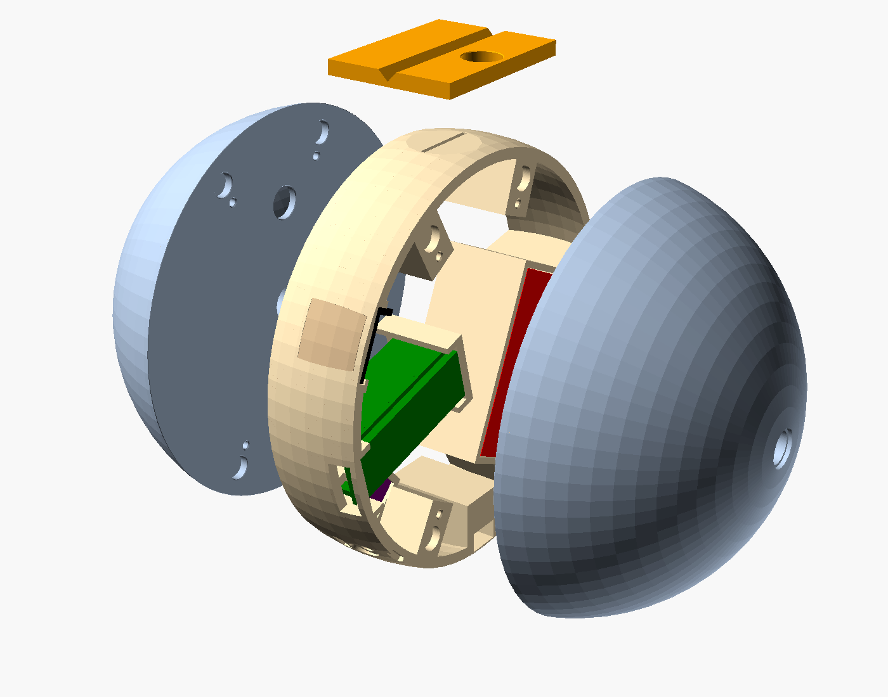
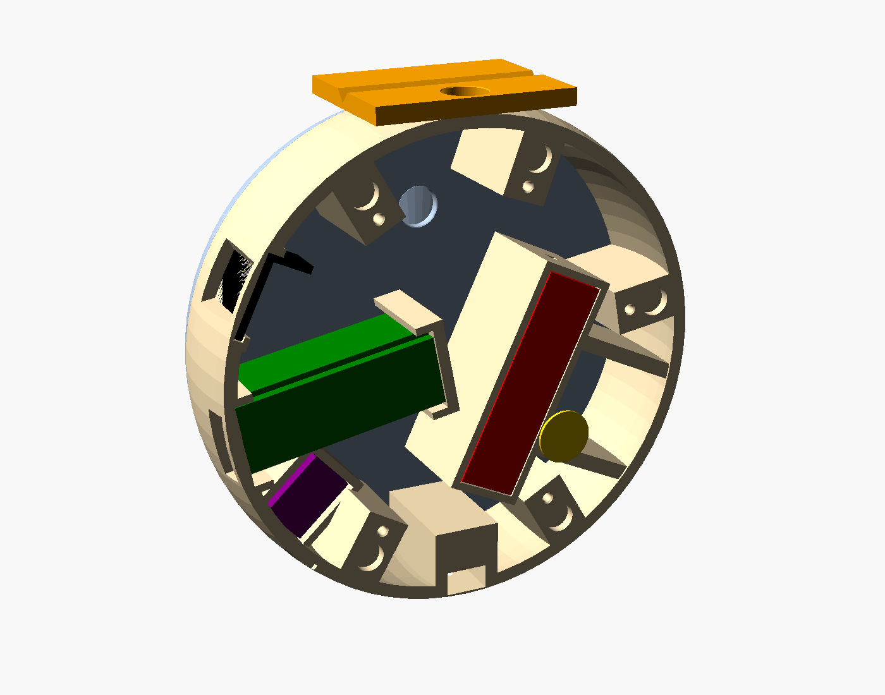

# Binaural sphere head

A 175 mm sphere that stands in for a head at a listening seat. Two Infineon IM73D122 PDM microphones sit flush in the surface at the ear points, ±90° from the front on the horizontal great circle, and one ESP32-S3 inside records both as stereo PDM on a shared clock. It measures interaural time and level differences (ITD, ILD) and interaural cross-correlation (IACC), to diagnose stereo imaging. Phase 1 of the binaural fixture: a sphere instead of a KEMAR-shaped head, no pinnae.

It runs from an 18650 cell inside the head, so it needs no cable while measuring, and it stands either on a 200 mm stem on a tripod or on a printed hook over a sofa backrest, where the listener's head would be. Every part prints on a Bambu Lab P2S (or any 256 × 256 × 256 mm printer) without supports.

## Parts

| Part | STL | Print orientation | Qty |
|---|---|---|---|
| Right cap (right ear, filled chamber) | `stl/binaural_sphere_head-cap_right.stl` | seam face down, ear up | 1 |
| Left cap (mirror of the right) | `stl/binaural_sphere_head-cap_left.stl` | seam face down, ear up | 1 |
| Centre slab (electronics, battery, display, tripod nut) | `stl/binaural_sphere_head-slab.stl` | left face down | 1 |
| Fill plug | `stl/binaural_sphere_head-fill_plug.stl` | flange down | 2 |
| Sight bar (laser and bubble level, for aiming) | `stl/binaural_sphere_head-sight_bar.stl` | top face down | 1 |
| Stand stem (200 mm, between tripod and head) | `stl/binaural_sphere_head-stem.stl` | upright, base down | 1 |
| OLED cover (flush plug for the display window) | `stl/binaural_sphere_head-oled_cover.stl` | inner face down | 1 |
| Sofa hook: saddle (∩ over the backrest) | `stl/binaural_sphere_head-hook_saddle.stl` | flat | 1 |
| Sofa hook: arm (hinged, carries the head) | `stl/binaural_sphere_head-hook_arm.stl` | flat | 1 |

On a Bambu Lab P2S, open the project files in `bambu/` instead: they carry the print settings below. Other 256 mm Bambu printers (X1C, P1S) take the same STLs.

**Hardware:** 10 × 10×3 mm neodymium disc magnets; 10 × 3×12 mm steel dowel pins (or M3×12 screw shanks with the heads cut off); 2 × 3/8"-16 hex nut (9/16" across flats, 21/64" thick), one in the head and one in the stem; 1 × 1/4"-20 hex nut (7/16" AF) in the stem base; 1 × 3/8"-16 threaded rod cut to 203 mm (`rod_cut`; the model echoes the exact `rod_len`); optional 3/8"→1/4"-20 brass reducer bushing to put the head straight on a camera tripod; a pen laser up to Ø14 mm; a Ø15 × 7 mm bullseye bubble level; cork granulate 2–4 mm (about 1.2 L) for the cap chambers; silicone or acoustic putty; double-sided foam tape.

**Power:** one protected 18650 Li-ion cell (button top, about 3000 mAh); a single-cell 18650 holder with wire leads (about 78 × 21 × 21 mm); a 1-cell charge + 5 V boost module with USB-C input and charge-while-discharge (about 25 × 21 mm, IP5306 class); a panel-mount mini toggle switch with an M6 thread at least 8 mm long (MTS-102 class); thin silicone wire; double-sided foam tape.

**Sofa hook:** 1 × M8 × 70 bolt, 2 × M8 washers, 1 × M8 rubber (EPDM) washer and 1 × M8 wing nut (pitch hinge); 1 × 3/8"-16 × 1½" (38 mm) hex bolt and 1 × 3/8"-16 thumb or jam nut (head mount).

## Why it's split this way

The head splits into a right cap, a 40 mm centre slab and a left cap, on two planes 20 mm either side of the centre. Each seam is then 67.5 mm from the nearest ear, and nothing but smooth dome surrounds either microphone. A hemisphere split on the vertical plane through the ears would run the seam across both ears. The sagittal hemisphere split keeps the ears clear but puts the electronics, tripod mount and display on the seam. The slab takes all of those, so each cap is a closed chamber (filled with cork) with an ear on top.

- **Caps print ear up.** The mic pocket is a vertical bore, so it comes out round and to size, and the dome needs no support. The chamber inside is closed, so its ceiling can't be supported: a 45° flare rises from the wire conduit to the shell and keeps the ceiling within 55° of vertical. The flare also makes the region around each ear solid.
- **The slab prints flat.** Every feature inside it (board cradle, OLED channel, tripod boss, joint tabs) is a vertical wall in print, so it needs no support either.
- **Walls** are 4.5 mm (10 lines of 0.45 mm). Shell vibration is further damped by the cork fill.
- **Seams** sit at ±20 mm, not at the centre: one central split would be 87.5 mm from each ear but would put the electronics, tripod nut and display on the seam. 40 mm is the narrowest slab that holds them with room for the jumpers.

## Print settings

| | |
|---|---|
| Material | PLA (stiff, accurate; indoor use). PETG also works. |
| Layer height | 0.2 mm (0.16 mm on the caps for a smoother dome, optional) |
| Walls | 4 (1.8 mm) |
| Top/bottom layers | 5 |
| Infill | 15% gyroid. Add a 40% modifier over the top 25 mm of each cap, so the solid around the ear is stiff as printed. Print the slab at 25% (tripod boss), and the stem and both hook parts at 40%. |
| Supports | None |
| Temperatures | Bambu PLA Basic preset (220 °C nozzle); generic PLA 200–220 °C, bed 60 °C |
| Time / filament (Bambu Studio, P2S, PLA Basic) | cap 6 h 1 min, 260 g each; slab (25%) 6 h 0 min, 226 g; hook saddle (40%) 6 h 16 min, 175 g; hook arm (40%) 1 h 50 min, 45 g; stem (40%) 1 h 48 min, 44 g; sight bar 23 min, 15 g; OLED cover and fill plugs a few minutes each; about 1.03 kg in all (about 28 h) |

Don't enable any slicer option that fills enclosed cavities: the caps are sealed hollow chambers by design.

The stem is a 200 mm tower on a Ø34 base: give it a 5 mm brim and lower the outer-wall acceleration or speed, or it may wobble near the top.

## Assembly

1. **Microphones.** Fit Dupont jumpers to each carrier's two 3-pin headers first. Feed the wires and housings down through the ear pocket into the conduit, then press the carrier in until it sits on the seat ring, port facing out. Its face should be flush with the dome at the rim, with the centre about 0.4 mm below the sphere. Seal the ring gap round the carrier with a thin bead of silicone or acoustic putty, wiped flush. The acoustic port must stay open and nothing may sit in front of it. Nothing else holds the carrier, so also fix it from inside: a few drops of CA glue or silicone where its rim meets the seat ring.
2. **Magnets and pins.** Glue the magnets into the pockets on both faces of the slab and on both cap plates. Check polarity before the glue sets. Put every slab magnet in north face out, on both faces, and every cap magnet south face out. Then any cap fits either side, and no magnet repels. A compass or a spare marked magnet tells the poles apart. Press the dowel pins into the slab (tight holes, 7 mm deep; glue them if they come out loose). The cap holes are a sliding fit.
3. **Tripod nut.** Drop the 3/8"-16 nut into the slot from the slab's right face. The right cap closes the slot. It sits 2 mm above the bottom flat.
4. **Stem.** Drop the 1/4"-20 nut into the lower slot of the stem base and a 3/8"-16 nut into the upper slot. Put a dab of glue or tape over each slot so the nuts can't slide out when the stem is handled. Screw the 203 mm rod down through the stem into the upper nut until it stops on the plastic under it; about 13.8 mm stands out of the top pad and passes right through the head nut. Screw the head onto the rod until its bottom flat sits on the pad, and the stem onto the tripod screw. The stem puts the tripod head 200 mm below the sphere, so its reflection arrives after the window used for the direct sound. Without the stem, a 3/8"→1/4" reducer bushing in the head nut takes a camera screw directly.
5. **ESP32.** Stick a strip of 1 mm double-sided foam tape on the top edge of the web. Put the board in pins-down (toward the left cap), USB-C end into the slot on the back, so it sits between the side fingers and the far-end stop. Put a 4–5 mm pad of soft foam on top of the module shield: the right cap's plate presses on it and keeps the board seated. Without it the board can float up and the USB-C receptacle can jam above the slot.
6. **OLED.** Slide the module into its channel from the slab's right face, glass toward the window, header edge up. The right cap's plate holds it along the slot. Put a strip of foam tape between the back of its PCB (below the header) and the channel, or a drop of hot glue at two corners, so the glass stays pressed against the window flat.
7. **Power.** Stick a strip of double-sided foam tape on the web of the charge-module cradle (bottom-back) and press the module onto it, USB-C toward its slot; add two dots of hot glue at its edges. Nothing else holds it in. Fit the toggle switch through the hole beside the slot and tighten its nut on the outside. Slide the 18650 holder into its cradle at the front of the bay from the right face (cell inserted), leads out through the notches at the floor of the end walls; a strip of foam tape along one side stops it rattling, and the right cap's plate holds it from above. Wire: holder → module battery input (B+ / B−); module 5 V output → switch → ESP32 **5V** pin; module GND → ESP32 **GND**. Charge by USB-C on the charge port; the module charges and powers the head at the same time.
8. **Wiring.** Pass the jumpers from each conduit mouth (centre of each cap plate) to the board. Leave enough slack to open the head.
9. **Fill** (below), then close: press each cap on, guided by the pins, until the magnets pull it home. To open, put a thumbnail or a plastic spudger in the pry notch at the bottom-back of each seam.

## Sofa hook

The hook hangs over the top of the backrest and puts the sphere where a seated listener's head is: centre `head_fwd` = 130 mm in front of the backrest and `head_up` = 0 mm above its top (both parameters). The arm and the sphere sit on the saddle's centreline, so the hook doesn't roll sideways. Measure your sofa first and set:

- `backrest_t`: backrest thickness at the top, cushion lightly pressed (default 160 mm; up to about 230 mm fits the bed);
- `head_up`: how far the listener's ear axis is above (+) or below (−) the backrest top.

Assembly: put the M8 bolt through the saddle's lug and the arm with the rubber washer between them and a steel washer under the bolt head and the wing nut. The rubber keeps the clamp from relaxing as the PLA creeps; tighten the wing nut firmly by hand and check the pitch again after a day. Push the 3/8"-16 × 1½" bolt up through the arm pad from below so its head drops into the hex pocket, thread the jam nut onto it, then screw the head on. Hang the saddle over the backrest, tilt the arm with the hinge until the bubble on the sight bar is level, and tighten the wing nut. Turn the head on the bolt to aim it (laser on the speakers' midpoint) and lock it by turning the jam nut up against the head's bottom flat.

With cork fill the head weighs about 1.0 kg; don't hang a sand-filled head (2.4 kg) on the hook.

The saddle is drawn for an upright backrest. A backrest that reclines 10–20° leaves the plate's foot off the cushion; the hinge takes up to ±8° of that, and a folded towel behind the plate foot takes up the rest. Not tried on a real sofa yet.

## Setting up for a measurement

- **Height and position.** Ear axis at listener ear height (1.2 m is the ISO 3382 default for a seated listener), and centred so the two tweeter distances match within 3 mm. Each centimetre off-centre shifts ITD by about 29 µs.
- **Aim.** Seat the sight bar on the top flat (its rib keys into the groove), level the head with the bubble, put a pen laser (up to Ø14 mm) in the V on top and turn the tripod until the dot lands on the midpoint between the speakers. One degree of yaw is 9–13 µs of ITD. Take the bar off before measuring.
- **OLED cover.** Press the cover into the display window until it is flush. Nothing latches it: the window faces 25° up, so it stays in, but a small loop of tape or a pea of putty on its seat keeps it there when you handle the head. Lift it out with a fingernail in the notch on its edge.
- **Cables.** Run on the battery: unplug both USB cables while measuring and plug the two slots with a strip of tape or foam. The ports then don't vent the bay. If you must run on a cable, wrap the plug in 1–2 mm closed-cell foam tape so it fills its slot.
- **Calibration.** Measure, pan the tripod exactly 180° (aim with the laser at the other way), and measure again: each mic then sits where the other was, so averaging the two runs cancels the mic mismatch in ITD and ILD. See the research report in `reports/`.

## Chamber fill: cork

Each cap holds 0.54 L of chamber volume. Fill both with cork granulate, 2–4 mm grain (it must pass the Ø14 mm fill port).

1. Stand the cap seam face up. Pour the granulate through the fill port, tapping and shaking the cap as you go, until it is packed full to the port. A loose fill rattles; packed grains damp the shell by friction, as sand does.
2. Press the fill plug in with a smear of silicone on its shank.

At a bulk density of about 0.1–0.15 g/cm³ (typical catalogue values, not measured) the fill adds 55–80 g per cap, and the whole head weighs about 1.0 kg with the battery (printed parts 0.75 kg, cork 0.13 kg, cell, holder and electronics about 0.1 kg). Sand (0.83 kg per cap, about 2.4 kg in all) still works on the tripod stem if you want extra mass, but not on the sofa hook. Open-cell foam or pillow fibre also works; it damps the air in the chamber more than the shell. Empty chambers work too: the 4.5 mm shell is stiff without a fill. How much any fill improves the measurement is not measured.

## Known compromises

- The sight rib and groove leave about ±0.25° of yaw play; aiming is limited by that and by how carefully you set the laser dot.
- The top flat (1.3 mm deep, Ø30) and its 1 mm groove sit on the median plane, 90° from both ears; the front notch is 0.5 mm deep.
- The band is notched inward above the ESP32 (3.7–4.5 mm instead of 4.5 mm), because the board's corners would hit the band on the way in from the seam. The front notch, pry notches, USB slot and OLED flat also thin the shell locally. All are on the back, front or bottom, at least 100 mm from the ears.
- The 2 mm strip of band between the OLED window and the right seam is slender. Handle that edge with care when the right cap is off.
- The electronics bay (about 0.8 L) vents through the USB slot, a Helmholtz resonance estimated at roughly 200 Hz (not measured). It is on the back, far from the ears; a loose wad of open-cell foam in the bay damps it.
- The dome terraces visibly within ~8 mm of each ear at 0.2 mm layers. Variable layer height (0.12 mm on the top 15 mm of each cap) smooths it.

## Battery

- **Runtime (estimate, not measured):** a 3000 mAh 18650 holds about 11 Wh; through a 5 V boost at about 85% that is about 9.4 Wh. The ESP32-S3 recording two mics with Wi-Fi on draws roughly 100–160 mA at 5 V (0.5–0.8 W), so expect 12–19 hours.
- **Charging:** USB-C into the charge port (bottom-back, next to the switch), 5 V. The module charges and powers the head at the same time.
- **Don't power the ESP32 from both sources at once** unless you have checked your board: switch the battery off before plugging a cable into the ESP32's own USB-C port for flashing. On some DevKitC clones the 5V pin and USB VBUS meet without a diode, and the two supplies would fight.
- Use a protected cell from a known brand. The cell sits in its own walled cradle, clear of the ESP32 and the conduits.
- **Data:** with no cable, the recordings must leave over Wi-Fi or go to storage on the board. That is the firmware's job, outside this fixture.

## Wiring notes

Both microphones share **CLK** and **DATA**; the ESP32-S3 records them as one stereo PDM stream (PDM RX on I2S0). The **SELECT** (L/R) pin goes to GND on one mic and to VDD on the other, so each drives DATA on a different clock edge. Power both from the board's 3.3 V. Which mic is "left" in the data, and which GPIOs carry CLK and DATA, are set in the firmware, not here. Keep the two jumper runs to similar length and twist each mic's CLK and DATA with a ground.

The OLED is I2C (GND, VCC, SCL, SDA on the header at its top edge).

## Measured parts (2026-11-23)

From the parts on hand and their AliExpress listings:

| Part | Listing | Value in the model |
|---|---|---|
| Mic carrier | "IM73D122 Digital MEMS Microphone Module" (item 1005013163488519) | `mic_pcb_d` 16.5 (15 across the two rim notches), `mic_pcb_t` 1.0, port at the centre (`mic_port_offset` 0), seat ring `mic_ledge` 1.0 so the bore behind it is 14.5 mm for the two 1×3 headers with Dupont housings (rows about 9.3 mm apart at 2.54 mm pitch, scaled from the listing photo). Pins: 1 3.3 V, 2 GND, 3 NC, 4 L/R, 5 CLOCK, 6 DATA. 3.3 V only. 8 mm over the pins. |
| ESP32-S3 | "ESP32-S3 Development Board DevKitC-1 … WROOM-1", N16R8, headers soldered (item 1005012092039320) | 28 × 64 mm at the widest points, 13 mm over the pins. `board_w` 28; `board_len` 71 allows for up to 7 mm of antenna overhang beyond the 64 mm (estimated from photos; set 64 if the 64 already includes the antenna). `board_angle` 191 (was 195) so the wider header rows clear the charge-module cradle. |
| OLED | "0.96 inch OLED IIC … SSD1306", white (item 1005006141235306); header GND, VCC, SCL, SDA | `oled_w` 27 (display width), `oled_h` 29 (header edge on top); 11.5 mm over the pins, with 18 mm left behind the PCB for the header and Dupont housings (`oled_pin_room`). Glass + PCB thickness and the active-area offset are still placeholders (below). |

## Placeholders: measure these before printing

Each is a parameter at the top of `binaural_sphere_head.scad`. Measure with calipers, set the value, re-render and re-export.

| Parameter | Default | What to measure |
|---|---|---|
| `board_comp_h` | 3.5 | Tallest part on the board's top side |
| `usb_open_w`, `usb_h` | 24, 3.2 | Span of the USB-C connector(s) across the board end, and receptacle height |
| — | — | Nothing on the board's underside along its centreline (the board rests on a 4 mm web there) |
| `oled_stack` | 3.0 | Glass + tape + PCB thickness |
| `oled_win_off`, `oled_win_h` | 0.0, 17 | Offset of the display's active area from the PCB centre (+ = away from the header). The window is 17 mm tall for a ~10.9 mm active area, so an offset of up to ±3 mm still shows the whole display; measure it and you can shrink the window. |
| `tnut_af`, `tnut_t` | 14.29, 8.33 | Your 3/8"-16 nuts (head and stem) |
| `tpod_af`, `tpod_t` | 11.11, 5.56 | Your 1/4"-20 nut in the stem base |
| `vial_d`, `vial_h` | 15, 7 | Your bullseye bubble level |
| `bat_len`, `bat_w`, `bat_h` | 78, 21, 21 | Your 18650 holder (length, width, height) |
| `pm_len`, `pm_w`, `pm_comp_h`, `pm_usb_w` | 25, 21, 4, 9 | Your charge module and its USB-C receptacle |
| `sw_d` | 6.2 | Your toggle switch's thread (M6) |
| `backrest_t`, `head_up` | 160, 0 | Your sofa: backrest thickness at the top, and ear height relative to the backrest top |

## Files

- `binaural_sphere_head.scad`: the parametric model. `part` selects a part; `all`, `explode` and `section` are views; `clash_*` are interference checks that must render empty.
- `stl/`: one STL per printed part.
- `bambu/`: Bambu Studio projects for the P2S with the settings above.
- `preview-*.png`: renders.
- `reports/Binaural sphere head design research.md`: the literature and product research behind v2, with the measurement procedure; `research_notes/` holds the sourced notes and the rigid-sphere scripts (`sphere.py`, `itd.py`).

## Design history

| Version | AI model | Date | Change |
|---|---|---|---|
| v1 | claude-opus-5-5 (final review: claude-fable-5-2) | 2026-11-22 | Initial design: three-part sphere (caps + centre slab), sealed sand chambers, flush mic pockets, ESP32/OLED bay, 1/4"-20 nut, magnet + dowel joints |
| v2 | claude-opus-5-5 (review: claude-sonnet-5-5) | 2026-11-23 | After the research report: top flat + groove and a sight bar (laser, bubble level) for aiming; 3/8"-16 nut and a 200 mm stand stem; front notch 1.5 → 0.5 mm; flush OLED cover |
| v3 | claude-opus-5-5 (review: claude-sonnet-5-5) | 2026-11-23 | Battery bay (18650 holder cradle, charge/boost module, USB-C charge port, toggle switch); sofa hook (saddle + hinged arm); cork fill instead of sand; Bambu projects for the P2S |
| v3.1 | claude-opus-5-5 | 2026-11-23 | Measured parts: mic pocket for the Ø16.5 × 1 mm carrier (port centred, 14.5 mm header bore); ESP32 cradle for 28 × 64 mm, turned 195° → 191°; OLED outline 27 × 29 mm; listings recorded |
